# Lab 02: Your first CI pipeline

Continuous integration means that every change is built and tested automatically, soon after someone pushes it. In this lab you run the lint and the tests of the flight status service on your machine, write the same steps as a Harness pipeline, run it, and read the logs of failed runs. You then add a trigger, so that every push starts the pipeline without a click, and you use expressions and conditions to report on each run.

**Lecture:** L3 Pipelines and Harness · **You need:** Lab 01. On a fresh machine, run `~/devops-demos/scripts/catch-up.sh 02` first (see the course README).

## Goals

- Run a project's lint and tests inside a container, without installing Python packages on your machine.
- Write a pipeline in YAML with several steps that share one workspace.
- Create and run the pipeline in Harness, and read its logs.
- Find the cause of a failed run in the logs, fix it, and run the pipeline again.
- Start the pipeline on every push with a trigger, and use expressions and conditions in steps.

## Before you start

Check that your repository and Harness are in place:

```bash
cd ~/flight-status
git status --short --branch
git log --oneline -1
docker ps --filter name=harness --format '{{.Names}} {{.Status}}'
```

You should see `## main...origin/main`, one commit, and `harness Up ...`. If `docker ps` says "permission denied", run `newgrp docker` in this terminal first.

## Part 1: Run the checks on your machine

### 1.1 Run the tests in a container

A pipeline runs your build and test commands on a clean machine. Before you write the pipeline, run the same commands yourself. You then know what success looks like and how long it takes. You run them in a container with Python 3.12. That way you install no Python packages on your lab machine, and you use the same image that the pipeline will use.

| Part of the command | What it does |
|---|---|
| `docker run --rm` | Starts a container and deletes it when the command ends. |
| `-v "$PWD":/src` | Mounts the current folder (your repository) into the container at `/src`. |
| `-w /src` | Makes `/src` the working folder inside the container. |
| `-e PYTHONDONTWRITEBYTECODE=1` | Stops Python from writing `.pyc` cache files into your folder. The container runs as root, so those files would belong to root. |
| `python:3.12-slim` | The image: Debian Linux with Python 3.12 and few other packages. |
| `sh -c "..."` | Runs two commands in the container: install the dependencies, then run pytest. `&&` runs the second command only if the first one succeeded. |

```bash
cd ~/flight-status
docker run --rm -v "$PWD":/src -w /src -e PYTHONDONTWRITEBYTECODE=1 python:3.12-slim \
  sh -c "pip install --quiet --root-user-action=ignore -r requirements-dev.txt && pytest"
```

The first run downloads the image and the dependencies, which takes about a minute. You should see a summary similar to this:

```text
SKIPPED [1] tests/integration/test_postgres.py:51: DATABASE_URL is not set
...
44 passed, 6 skipped in 0.62s
```

The 6 skipped tests are integration tests. They need a PostgreSQL database and run only when `DATABASE_URL` is set. Lab 03 runs them. Keep in mind that a skipped test did not check anything in this run.

### 1.2 Run the linter

A linter reads code without running it and reports likely mistakes, such as an unused import or a name that is never defined. A formatter rewrites code into one consistent layout. This project uses ruff for both:

- `ruff check .` lists problems in all Python files.
- `ruff format --check .` lists the files whose layout the formatter would change, without changing them.

In a pipeline you always use the `--check` form. A pipeline should report problems, not edit your code.

```bash
docker run --rm -v "$PWD":/src -w /src python:3.12-slim \
  sh -c "pip install --quiet --root-user-action=ignore ruff==0.17.2 && ruff check . && ruff format --check ."
```

You should see:

```text
All checks passed!
14 files already formatted
```

## Part 2: Write the pipeline

### 2.1 Create the pipeline file

Harness Open Source reads pipelines from YAML files in the repository, in the `.harness` folder. Keeping the pipeline next to the code is called "pipeline as code". A change to the pipeline is then reviewed, versioned and, if needed, reverted like any other change.

Create the folder:

```bash
mkdir -p ~/flight-status/.harness
```

Create the file `~/flight-status/.harness/ci.yaml` in VS Code, paste the content below, and save it. Indent with spaces. YAML does not allow tabs.

<!-- vscode:begin -->
In VS Code, open the folder `~/flight-status` with **File** > **Open Folder** if it is not open yet. Then:

1. In the Explorer, select the **New File** button next to the folder name.
2. Type the path of the new file, `.harness/ci.yaml`, and press Enter.
3. Copy the content with the copy button of the code block below. Click into the empty editor and paste with Ctrl+V.
4. Save with Ctrl+S. The dot on the editor tab disappears when the file is saved.

Create the other files in the labs the same way. For a file outside the open folder, select **File** > **New Text File**, paste the content, and save it with **File** > **Save As** under the path that the lab gives.

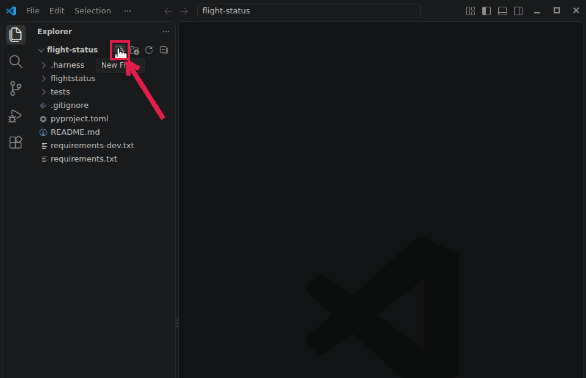

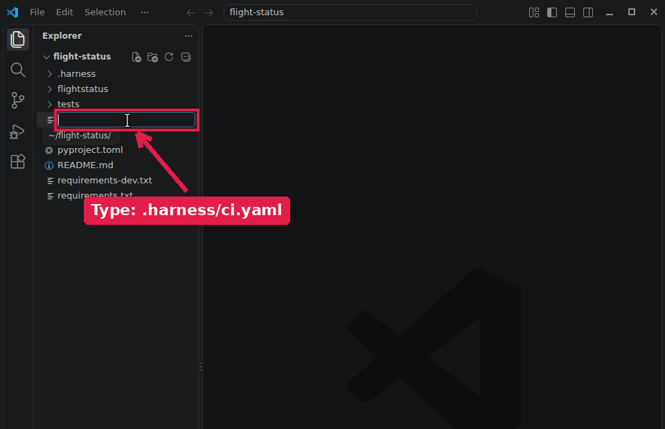

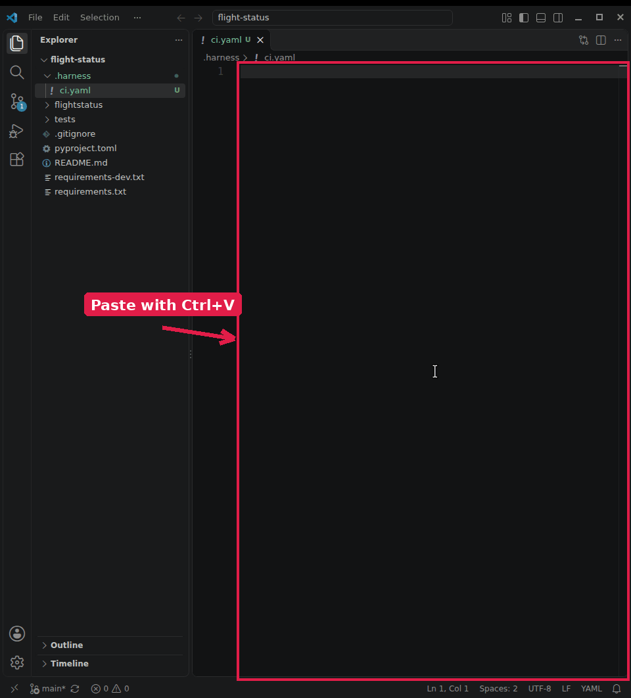

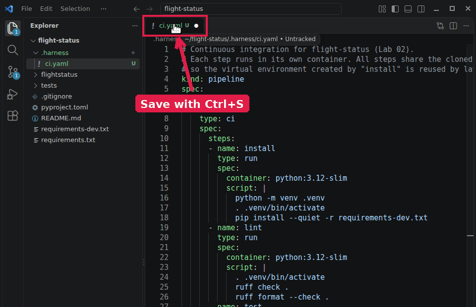

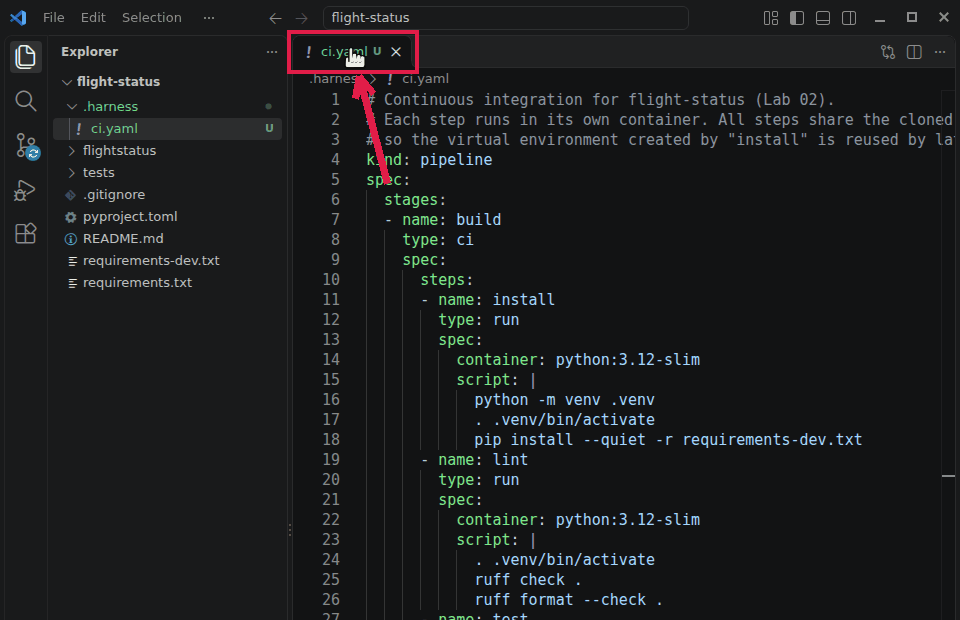

<!-- vscode:end -->

<!-- file: ~/flight-status/.harness/ci.yaml -->
```yaml
# Continuous integration for flight-status (Lab 02).
# Each step runs in its own container. All steps share the cloned workspace,
# so the virtual environment created by "install" is reused by later steps.
kind: pipeline
spec:
  stages:
  - name: build
    type: ci
    spec:
      steps:
      - name: install
        type: run
        spec:
          container: python:3.12-slim
          script: |
            python -m venv .venv
            . .venv/bin/activate
            pip install --quiet -r requirements-dev.txt
      - name: lint
        type: run
        spec:
          container: python:3.12-slim
          script: |
            . .venv/bin/activate
            ruff check .
            ruff format --check .
      - name: test
        type: run
        spec:
          container: python:3.12-slim
          script: |
            . .venv/bin/activate
            pytest
```

### 2.2 Read the pipeline

Read the file from top to bottom before you continue:

- `kind: pipeline` says that the file describes a pipeline.
- `spec.stages` is a list of stages. A stage is a group of steps that run with one shared workspace. This pipeline has one stage, `build`, of type `ci`.
- `steps` run in order, from top to bottom. If a step fails, Harness skips the steps after it.
- `type: run` starts a container from the `container` image and runs the `script` in it with `/bin/sh`. The step fails as soon as one line of the script fails.
- Before the first step, Harness clones your repository into a workspace folder and mounts that folder into every step container. Each step is a new container, but all of them see the same files.
- The `install` step creates a Python virtual environment, `.venv`, inside the workspace, and installs the dependencies into it. The `lint` and `test` steps activate the same `.venv` and reuse the packages. Anything a step installs outside the workspace disappears when that step's container ends.
- Step names contain only letters and digits. Harness removes other characters, such as dashes, from step names.

The Harness platform uses the same structure: a pipeline contains stages, and stages contain steps. A CI stage there is called a Build stage, and the image for a Run step comes from a container registry through a connector.

### 2.3 Commit and push the pipeline

```bash
cd ~/flight-status
git add .harness/ci.yaml
git commit -m "Add the CI pipeline"
git push
```

Nothing runs yet. Harness does not know about the file until you create a pipeline that points to it.

## Part 3: Create and run the pipeline in Harness

### 3.1 Create the pipeline

In Harness, open the `flight-status` repository and select **Pipelines**. Select **New Pipeline** and enter:

- Name: `ci`
- Branch: `main`
- YAML path: `.harness/ci.yaml`

Select **Create**. Harness opens the pipeline and shows your YAML.


<!-- shots:begin -->
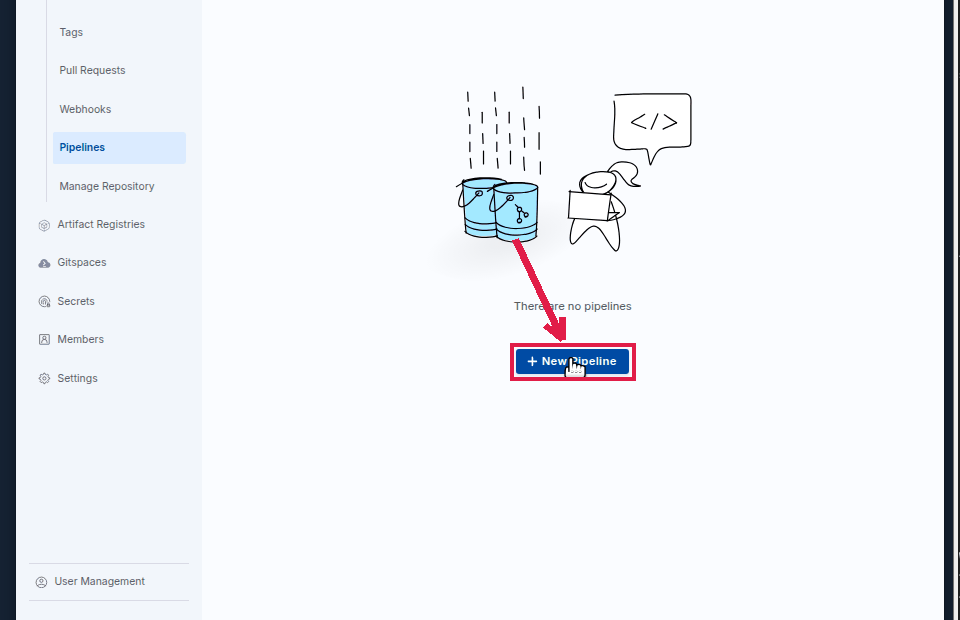

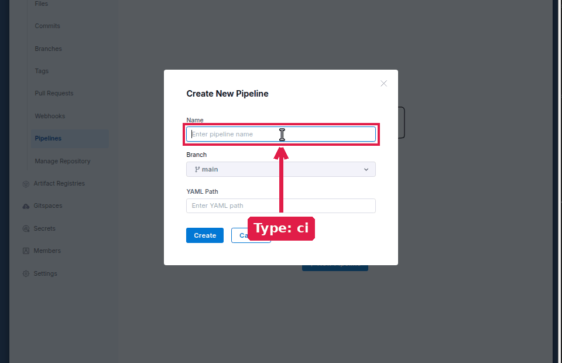

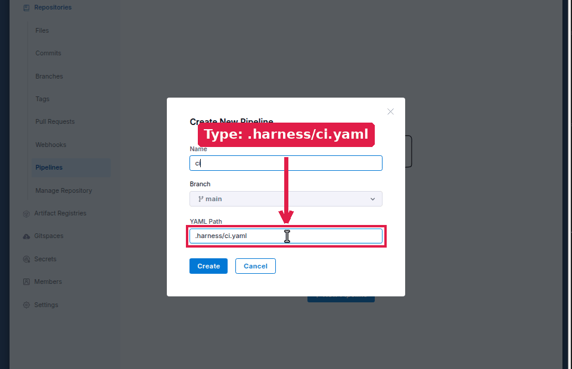

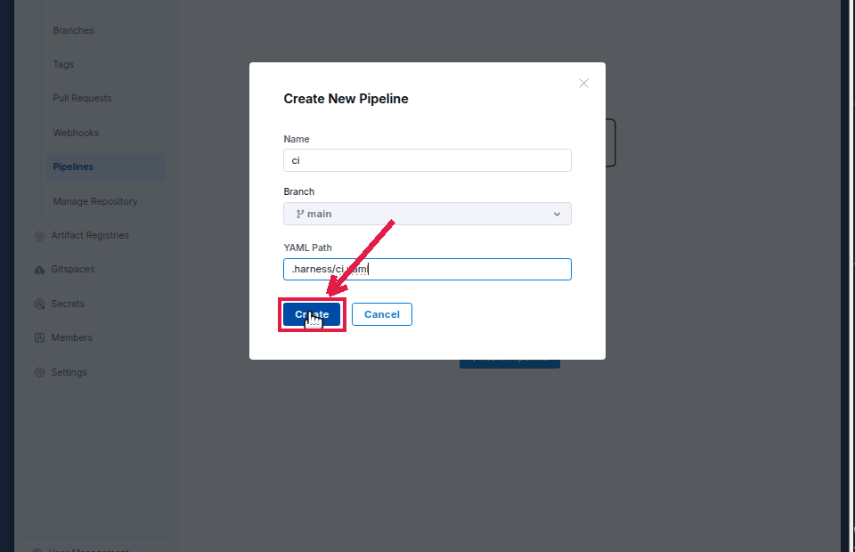

<!-- shots:end -->

<!-- ui: create_pipeline flightops/flight-status ci .harness/ci.yaml -->

The name `ci` is also the pipeline's identifier. In Lab 03, the branch rule that protects `main` refers to the pipeline by this identifier.

### 3.2 Run the pipeline

Select **Run**, keep the branch `main`, and confirm. Harness creates an execution with the number 1.


<!-- shots:begin -->
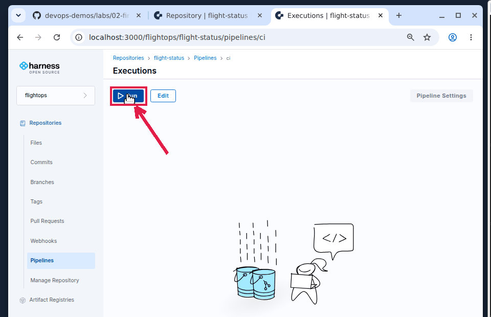


<!-- shots:end -->

<!-- ui: run_pipeline flightops/flight-status ci main -->

<!-- test
h_wait flightops/flight-status ci success
-->

### 3.3 Read the execution

Open the execution and select each step to see its log.


<!-- shots:begin -->
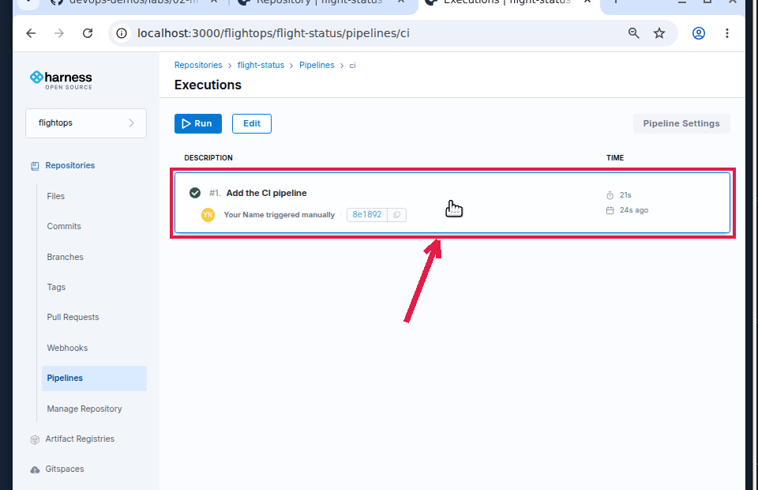

<!-- shots:end -->

<!-- ui: view_execution flightops/flight-status ci -->

Look for these details:

- The **clone** step, which Harness adds before your steps. It clones the repository at the commit that this run builds.
- At the start of each step, the lines where Docker pulls the container image. The first run downloads `python:3.12-slim`. Later runs reuse it from the Docker image cache on your machine.
- The duration of **install**. It is the slowest step, because it downloads all dependencies. Harness Open Source has no cache between runs, so every run downloads them again.
- In **test**, the same summary that you saw in Part 1: `44 passed, 6 skipped`.

The steps ran as containers on your own machine, started by the Harness container through the Docker socket. While a run is in progress, `docker ps` shows the step containers next to the `harness` container.

## Part 4: Read a failed run

### 4.1 Introduce a bug

You will spend much of your time with pipelines on runs that failed. You practise reading a failure now, with a bug that you know about.

The `sed` command below edits `rules.py`, so that a flight may go from SCHEDULED straight to ARRIVED. `git diff` shows the change.

```bash
cd ~/flight-status
sed -i 's/S.SCHEDULED: {S.BOARDING, S.DELAYED, S.CANCELLED},/S.SCHEDULED: {S.BOARDING, S.DELAYED, S.CANCELLED, S.ARRIVED},/' flightstatus/rules.py
git diff
```

You should see one changed line:

```text
-    S.SCHEDULED: {S.BOARDING, S.DELAYED, S.CANCELLED},
+    S.SCHEDULED: {S.BOARDING, S.DELAYED, S.CANCELLED, S.ARRIVED},
```

Commit and push the change:

```bash
git commit -am "Allow flights to arrive without departing"
git push
```

### 4.2 Run the pipeline and read the failure

Run the pipeline again from Harness: **Run**, branch `main`. There is no trigger yet, so a push does not start a run by itself.


<!-- shots:begin -->
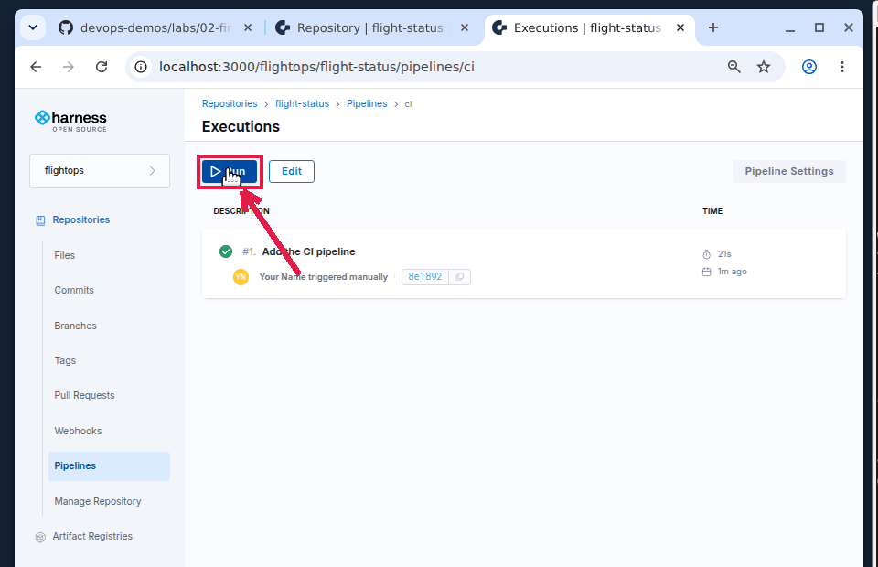

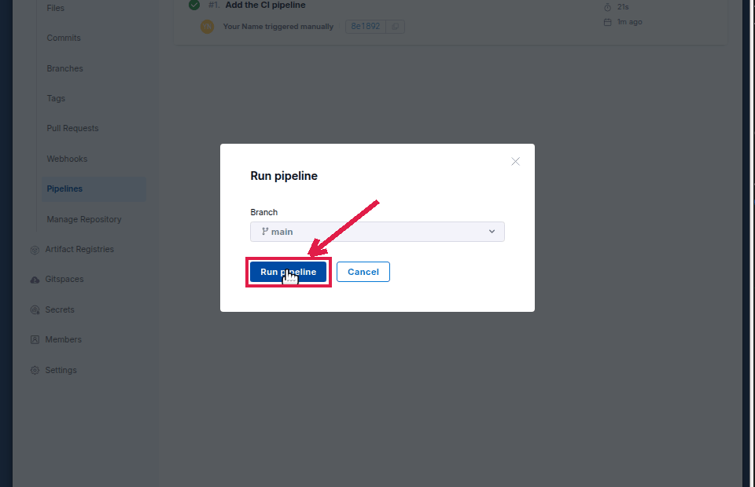

<!-- shots:end -->

<!-- ui: run_pipeline flightops/flight-status ci main -->

<!-- test
h_wait flightops/flight-status ci failure
h_log flightops/flight-status ci test | grep -q 'test_forbidden_transitions'
-->

Open the run. The **test** step is red. If more steps followed it, Harness would skip them.

Read the log of **test** from the bottom up. The last lines summarize the result:

```text
FAILED tests/api/test_api.py::test_forbidden_status_update_returns_409 - assert 200 == 409
FAILED tests/unit/test_rules.py::test_forbidden_transitions[SCHEDULED-ARRIVED] - AssertionError: assert not True
FAILED tests/unit/test_rules.py::test_forbidden_update_raises_with_reason - Failed: DID NOT RAISE InvalidTransition
3 failed, 41 passed, 6 skipped in 0.40s
```

Then scroll up to the details of each failure. pytest shows the test function, the `assert` line that failed, and the values it compared.

Three tests found the bug, at two levels:

- The unit test `test_forbidden_transitions` checks the rule itself. Its name and parameters point to the cause: the change from SCHEDULED to ARRIVED is now allowed.
- The unit test `test_forbidden_update_raises_with_reason` expected an error when a flight goes from SCHEDULED to ARRIVED. The error did not come.
- The API test sends the request a client would send and expected a `409 Conflict` answer. It received `200 OK`. It shows the effect, but not the cause.

pytest ends with exit code 1 when a test fails. Harness marks a step as failed when its script ends with any exit code other than 0. Every tool in a pipeline reports failure to Harness this way.

### 4.3 Undo the bug

`git revert` creates a new commit that undoes an earlier commit. The history keeps both commits: what went wrong, and that it was undone. On a shared branch, a revert is safer than rewriting history, because other people may already have the bad commit.

```bash
git revert --no-edit HEAD
git push
git log --oneline -3
```

Run the pipeline again from Harness. It is green again.


<!-- shots:begin -->
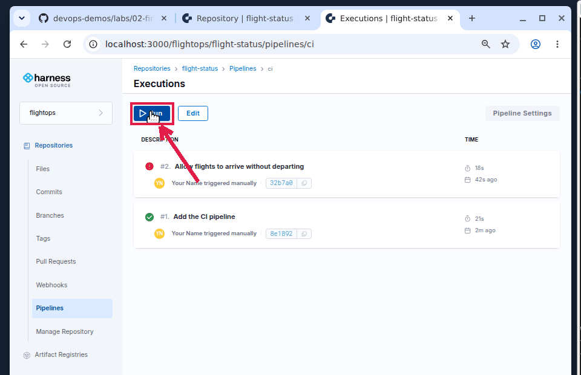

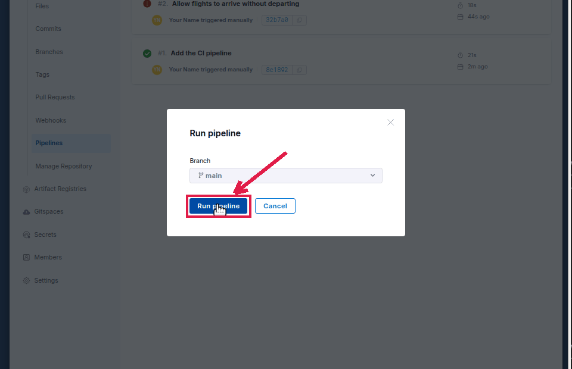

<!-- shots:end -->

<!-- ui: run_pipeline flightops/flight-status ci main -->

<!-- test
h_wait flightops/flight-status ci success
-->

## Part 5: Run the pipeline on every push

### 5.1 Add a push trigger

Continuous integration means that every change is checked, without anyone having to remember to select **Run**. A trigger starts a pipeline when an event happens in the repository. When you create a pipeline, Harness adds a default trigger for pull request events. You add a trigger for pushes.

In the `ci` pipeline, open its settings (**Settings**), then the **Triggers** tab, and select **New Trigger**. Name it `push`, select the event **Branch updated**, and create it.


<!-- shots:begin -->
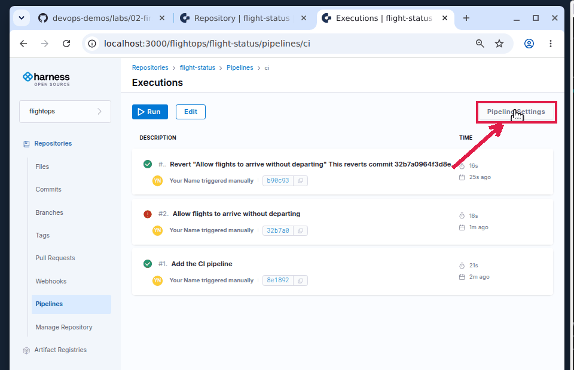

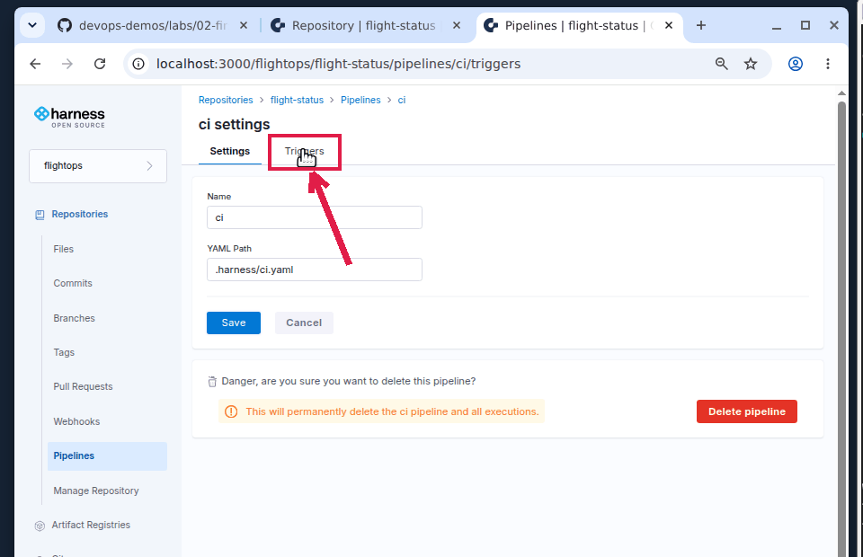

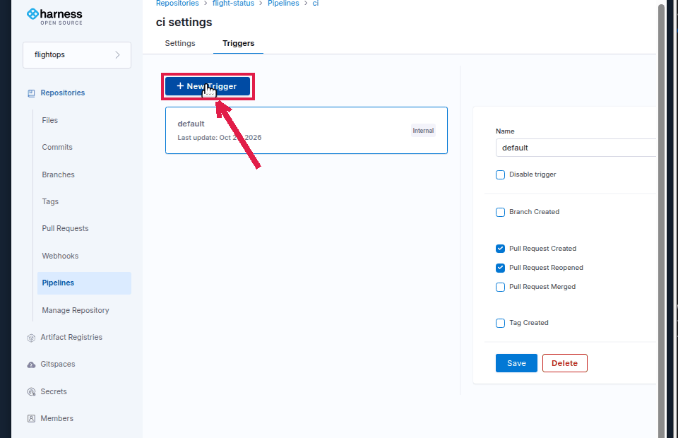

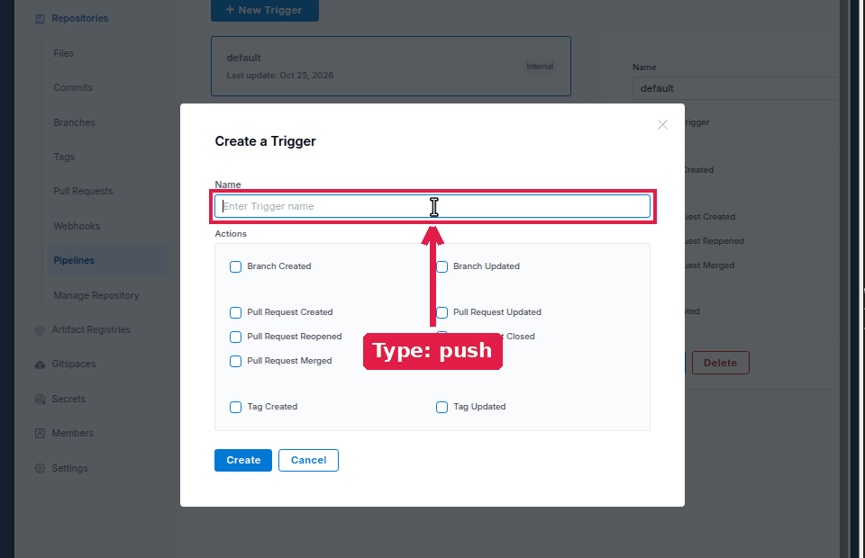

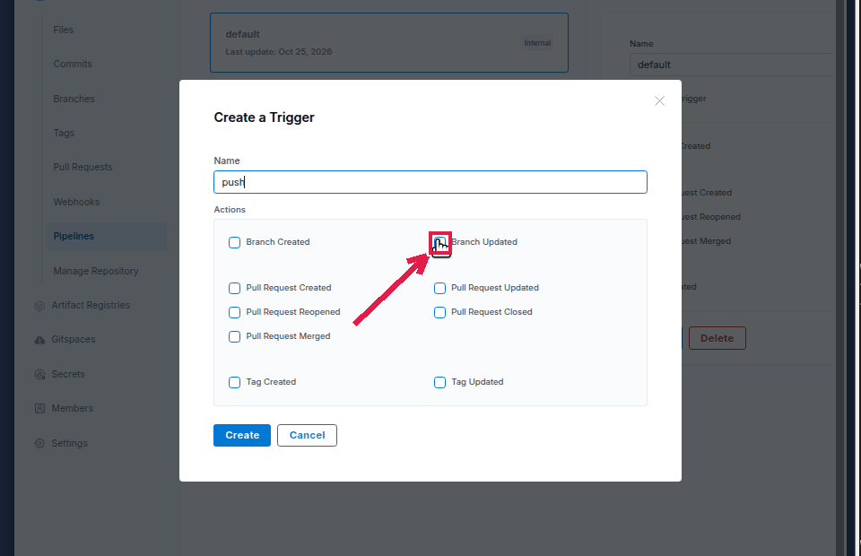

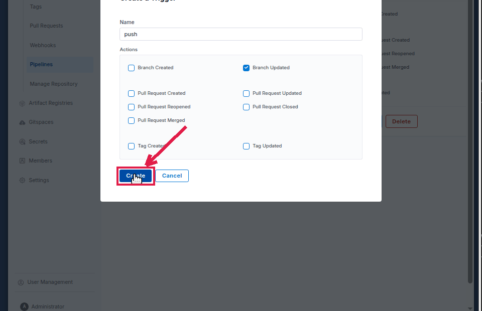

<!-- shots:end -->

<!-- ui: add_trigger flightops/flight-status ci push branch_updated -->

"Branch updated" happens when new commits are pushed to a branch that exists already. Pushing a new branch is a different event, "Branch created". In Lab 03 you will see what this difference means for feature branches.

### 5.2 Push a change

Add a short section to the README and push it:

```bash
cd ~/flight-status
cat >> README.md <<'EOF'

## Continuous integration

The `ci` pipeline in `.harness/ci.yaml` lints and tests every push.
EOF
git commit -am "Describe the CI pipeline in the README"
git push
```

Open **Pipelines** > **ci** in Harness. A new execution starts within a few seconds, without a click. Its details show that a push started it.

<!-- test
h_wait flightops/flight-status ci success
-->

Triggers in the Harness platform work the same way. They also support schedules (cron) and artifact events, such as a new image in a registry.

## Part 6: Expressions and conditions

### 6.1 Add a report step

A pipeline often needs information about the run itself: its number, the commit, the event that started it. Harness provides this information as expressions, written `${{ ... }}`. Harness replaces each expression with its value before the step starts.

A condition, written `when:`, decides whether a step runs:

- `when: always()` runs the step even after an earlier step failed. Use it for reports and notifications.
- `when: failure()` runs the step only when an earlier step failed.
- A comparison such as `when: build.event == "push"` runs the step only for some events. You use this in Lab 09.

Replace the content of `.harness/ci.yaml` with the version below. The new part is the `report` step at the end. It uses a small Alpine Linux image, because it only prints text.

<!-- file: ~/flight-status/.harness/ci.yaml -->
```yaml
# Continuous integration for flight-status (Lab 02).
# Each step runs in its own container. All steps share the cloned workspace,
# so the virtual environment created by "install" is reused by later steps.
kind: pipeline
spec:
  stages:
  - name: build
    type: ci
    spec:
      steps:
      - name: install
        type: run
        spec:
          container: python:3.12-slim
          script: |
            python -m venv .venv
            . .venv/bin/activate
            pip install --quiet -r requirements-dev.txt
      - name: lint
        type: run
        spec:
          container: python:3.12-slim
          script: |
            . .venv/bin/activate
            ruff check .
            ruff format --check .
      - name: test
        type: run
        spec:
          container: python:3.12-slim
          script: |
            . .venv/bin/activate
            pytest
      - name: report
        type: run
        when: always()
        spec:
          container: alpine:3.20
          script: |
            echo "Build number: ${{ build.number }}"
            echo "Commit:       ${{ build.commit }}"
            echo "Event:        ${{ build.event }}"
            echo "Branch:       ${{ build.target }}"
```

```bash
cd ~/flight-status
git commit -am "Report build information at the end of each run"
git push
```

<!-- test
h_wait flightops/flight-status ci success
h_log flightops/flight-status ci report | grep -q 'Event: *push'
-->

Open the run and the log of **report**. You should see values similar to these:

```text
Build number: 5
Commit:       3f1c2a9e0b7d4c51a2e86f0d9b3c7a1e5f4d2c60
Event:        push
Branch:       main
```

Before each step's output, the log shows the script itself, in lines that start with `+`. In those lines the expressions are already replaced by their values. Lab 06 shows why this matters when a value is a secret.

The Harness platform uses a different expression syntax for the same information, for example `<+pipeline.sequenceId>` for the run number and `<+codebase.commitSha>` for the commit.

## Part 7: A lint failure

### 7.1 Add an unused import

Not every failure is a failing test. Here the linter stops the pipeline before the tests run. The `sed` command adds `import json` to `rules.py`. Nothing in the file uses it.

```bash
cd ~/flight-status
sed -i 's/^from datetime import datetime, timedelta$/import json\nfrom datetime import datetime, timedelta/' flightstatus/rules.py
git diff
git commit -am "Import json in the rules module"
git push
```

<!-- test
h_wait flightops/flight-status ci failure
h_log flightops/flight-status ci lint | grep -q 'F401'
-->

Open the new run:

- **lint** failed. Its log names the rule (`F401`), the problem (`` `json` imported but unused ``) and the location (`flightstatus/rules.py`, line 7).
- **test** was skipped, because an earlier step failed.
- **report** ran anyway, because of `when: always()`. Its log shows the same build information as before.

`[*]` next to the rule code means that ruff can fix this problem by itself with `ruff check --fix`.

### 7.2 Fix it

```bash
git revert --no-edit HEAD
git push
```

<!-- test
h_wait flightops/flight-status ci success
-->

The pipeline is green again.

## Troubleshooting

- **Harness cannot find the YAML file when you create the pipeline**: The file must be pushed to `main` first, and the YAML path must be `.harness/ci.yaml`, with no other characters. Check what the server has with `git ls-tree -r origin/main --name-only | grep harness`.
- **An error such as `yaml: line 12: did not find expected key`**: Usually indentation. YAML uses spaces, never tabs, and each level here is two spaces. Compare your file with `~/devops-demos/solutions/lab02/flight-status/.harness/ci.yaml`.
- **The `install` step fails with a network error**: The step container needs internet access to download packages. Run the pipeline again. If it keeps failing, check that the machine reaches PyPI: `curl -sI https://pypi.org | head -1`.
- **`.venv/bin/activate: not found` in `lint` or `test`**: The `install` step did not run or failed. Steps share the workspace only within one run.
- **`lint` fails with `File would be reformatted`**: A file does not match ruff's layout. Run the formatter in a container: `docker run --rm -v "$PWD":/src -w /src python:3.12-slim sh -c "pip install --quiet --root-user-action=ignore ruff==0.17.2 && ruff format ."`, then commit the change.
- **A push does not start a run**: Open the pipeline settings, tab Triggers. The trigger needs the event "Branch updated" and must be enabled.
- **`git push` is rejected with `fetch first`**: The server has commits that you do not have. Run `git pull --rebase` and push again.

<!-- runner: stop -->

## Going further (optional)

- **Where does the time go?** Compare the duration of `install` with the other steps over several runs. Write down two ways to make it faster. (Two common answers: a prebuilt image that already contains the dependencies, or a dependency cache. The Harness platform offers caching for Build stages.)
- **Report failures.** Add a step after `report` with `when: failure()` that prints `The pipeline failed in run ${{ build.number }}`. Push a change that breaks a test, check that the step runs, and revert the change.
- **Check the dependencies.** Add a step `audit` that runs `pip-audit` on `requirements.txt`: `pip install --quiet pip-audit && pip-audit -r requirements.txt`. Should a known vulnerability in a dependency fail the pipeline? Discuss what happens on the day a new vulnerability is published for a package you use.
- **Compare with the solution.** Read `~/devops-demos/solutions/lab02/flight-status/.harness/ci.yaml` and compare it with your file.

## Summary

- You ran the lint and the tests in a container, the same way the pipeline runs them. That showed you what success looks like before you automated it.
- You wrote a pipeline as code, with steps that run in separate containers and share one workspace.
- You read two failed runs. A failing test pointed to the rule that changed. A lint error stopped the run before the tests, and later steps were skipped.
- You reverted bad commits with `git revert`, which keeps the history of what happened.
- You added a push trigger, so every change is checked, and used expressions and the `always()` condition to report on each run.
