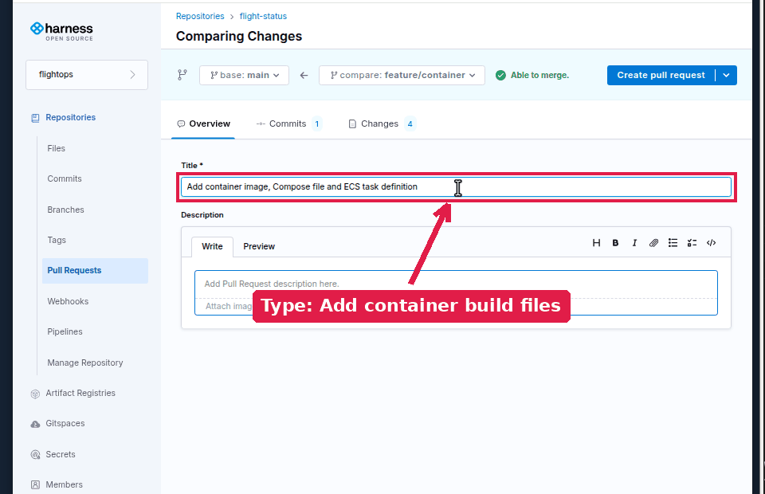
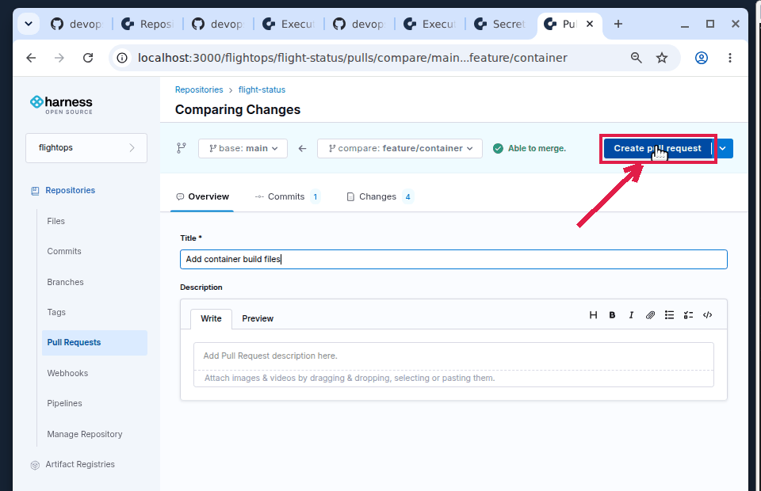
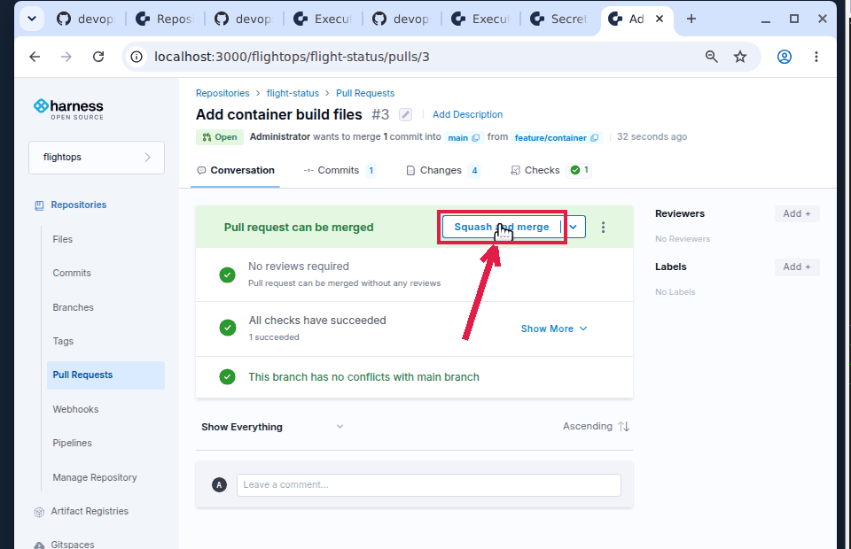
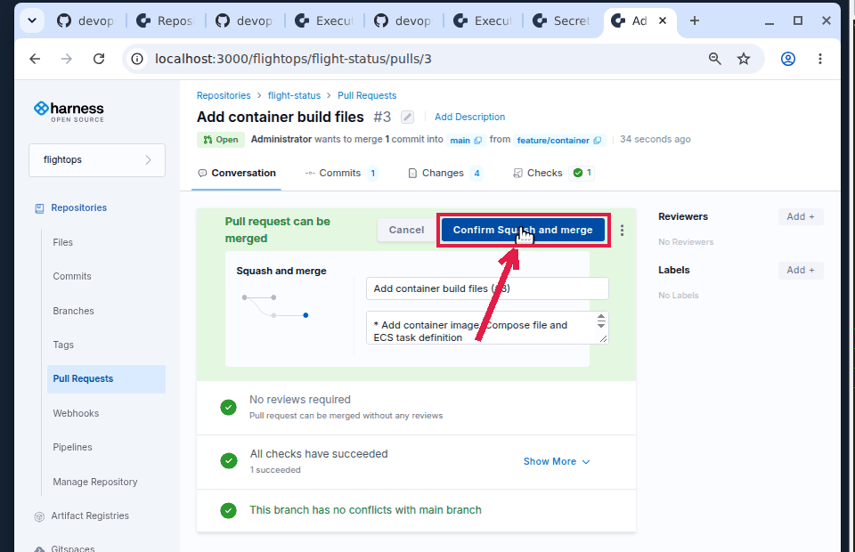

# Lab 07: Build, scan and describe a container

In this lab you package the flight status service as a container image. You write a Dockerfile, build the image, run it and look at its layers. You push the image to the local registry, scan it for known vulnerabilities, and produce a software bill of materials (SBOM). Then you run the service together with PostgreSQL using Docker Compose. Finally, you describe the same container as an Amazon ECS task definition, the format that AWS Fargate runs. Lab 08 deploys the image you build here to Kubernetes.

**Lecture:** L9 Containers and L10 Compose, ECS task definitions and Fargate · **You need:** Lab 06 (or: run `~/devops-demos/scripts/catch-up.sh 07` on a fresh machine)

## Goals

- Write a Dockerfile that produces a small image and runs the service as an unprivileged user.
- Explain image layers, the build cache, tags and digests.
- Push an image to a registry and look up its digest.
- Scan an image with Trivy and produce an SBOM.
- Run a two-container application with Docker Compose and map it to an ECS task definition for Fargate.

## Before you start

You work in the `flight-status` repository on your machine. Lab 06 left you on the `main` branch. Update your copy of `main` from the server, and check that Harness, the k3d cluster and the registry are running.

```bash
cd ~/flight-status
git switch main
git pull
git status --short
docker ps --format '{{.Names}}' | sort
kubectl get nodes
```

You should see output like this:

```text
Already up to date.
harness
k3d-devops-server-0
k3d-devops-serverlb
k3d-registry.localhost
NAME                  STATUS   ROLES           AGE   VERSION
k3d-devops-server-0   Ready    control-plane   1d    v1.34.12+k3s1
```

`git status --short` prints nothing when you have no uncommitted changes. If it lists files, commit or discard them before you continue.

## Part 1: Install Trivy

### 1.1 Download Trivy 0.75.0 and check its checksum

Trivy is an open-source scanner from Aqua Security. It lists the operating system packages and language libraries inside an image. It then compares them with a database of known vulnerabilities, which are published as CVE records.

The pipeline you build in Lab 09 scans images with the `aquasec/trivy:0.75.0` container image. If you install the same version on your machine, a scan gives the same result in both places. A different scanner version can report different findings for the same image.

Aqua's apt repository offers only the newest Trivy release, so apt cannot install an older version. You download the 0.75.0 package from the release page on GitHub instead, and check it against the checksums that Aqua publishes with the release, as you did for k3d in Lab 04.

```bash
mkdir -p ~/downloads && cd ~/downloads
curl -fsSLO https://github.com/aquasecurity/trivy/releases/download/v0.75.0/trivy_0.75.0_Linux-64bit.deb
curl -fsSLO https://github.com/aquasecurity/trivy/releases/download/v0.75.0/trivy_0.75.0_checksums.txt
sha256sum --check --ignore-missing trivy_0.75.0_checksums.txt
```

You should see:

```text
trivy_0.75.0_Linux-64bit.deb: OK
```

`--ignore-missing` skips the lines for the files you did not download. The release also publishes a Sigstore signature for each file, in the `.sigstore.json` files next to it. Lecture L9 explains what a signature adds to a checksum.

### 1.2 Install the package

`apt-get install` with the path to a `.deb` file installs that file, and any packages it needs from the Ubuntu repositories.
`-o DPkg::Lock::Timeout=300` makes apt wait up to five minutes if Ubuntu's automatic updates are installing packages at the same moment, instead of failing.

```bash
sudo apt-get -o DPkg::Lock::Timeout=300 install -y ./trivy_0.75.0_Linux-64bit.deb
trivy --version
cd ~
```

You should see:

```text
Version: 0.75.0
```

<!-- test
trivy --version | grep -q "0.75.0"
-->

## Part 2: Write the Dockerfile

### 2.1 Create a branch

Since Lab 03, the `main` branch only accepts changes through pull requests. Start a branch for the container files.

```bash
cd ~/flight-status
git switch -c feature/container
```

### 2.2 What a Dockerfile contains

A Dockerfile is a list of instructions. `docker build` runs them in order. Most instructions add a layer to the image. A layer is a read-only set of file changes, for example "these files were added under `/app`". The finished image is the stack of layers plus some settings: environment variables, the user, and the command to start.

When you build again, Docker reuses a layer from its cache if the instruction and its inputs have not changed. As soon as one layer changes, Docker rebuilds that layer and every layer after it. For this reason, a Dockerfile lists things that rarely change (the base image, the dependencies) first, and things that change often (your code) last.

The table explains each instruction of the Dockerfile you are about to create.

| Instruction | What it does and why |
|---|---|
| `FROM python:3.12-slim` | Starts from the official Python image. It is based on Debian, and the `slim` variant leaves out compilers and documentation. The full `python:3.12` image is several times larger and contains far more packages that a scanner can flag. |
| `ENV PYTHONDONTWRITEBYTECODE=1 PYTHONUNBUFFERED=1` | Stops Python from writing `.pyc` files, and sends each log line to standard output at once. `docker logs` and Kubernetes read the logs from standard output. |
| `WORKDIR /app` | Creates `/app` and makes it the working directory for the following instructions and for the running container. |
| `COPY requirements.txt .` and `RUN pip install ...` | Installs the dependencies in their own layer. Docker rebuilds this layer only when `requirements.txt` changes. `--no-cache-dir` keeps pip's download cache out of the image. |
| `COPY flightstatus/ flightstatus/` | Copies the application code. A code change rebuilds this layer and the ones after it, and reuses the dependency layer. |
| `ARG` and `ENV` for `APP_VERSION` and `GIT_COMMIT` | `ARG` declares a value you pass at build time with `--build-arg`. `ENV` stores it in the image, so the service can show it at `/version`. These lines come after the dependency layer, so a new version number does not reinstall the dependencies. |
| `RUN useradd ...` and `USER 10001` | Creates an unprivileged user and runs the service as that user, not as root. The user is given as a number, so Kubernetes can check that the container does not run as root (Lab 08 uses that check). |
| `EXPOSE 8000` | Records that the service listens on port 8000. It does not publish the port. You publish ports when you run the container. |
| `CMD [...]` | The command the container runs. The JSON form (exec form) starts uvicorn as process 1 in the container, without a shell in between. Process 1 receives the stop signal from Docker or Kubernetes, so the service can shut down cleanly. |

### 2.3 Create the Dockerfile

In VS Code (or the Text Editor), create the file `Dockerfile` (no file extension) in `~/flight-status` with this content and save it.

<!-- file: ~/flight-status/Dockerfile -->
```dockerfile
# Container image for the flight status API (Lab 07).
FROM python:3.12-slim

# Do not write .pyc files, and send log output straight to the terminal.
ENV PYTHONDONTWRITEBYTECODE=1 \
    PYTHONUNBUFFERED=1

WORKDIR /app

# Install the dependencies first. Docker reuses this layer from its cache
# until requirements.txt changes, so code changes rebuild quickly.
COPY requirements.txt .
RUN pip install --no-cache-dir --root-user-action=ignore -r requirements.txt

# Copy the application code.
COPY flightstatus/ flightstatus/

# Version information, passed in at build time with --build-arg.
ARG APP_VERSION=dev
ARG GIT_COMMIT=unknown
ENV APP_VERSION=${APP_VERSION} \
    GIT_COMMIT=${GIT_COMMIT}

# Run as an unprivileged user, not as root.
RUN useradd --uid 10001 --no-create-home --shell /usr/sbin/nologin app
USER 10001

EXPOSE 8000
CMD ["uvicorn", "flightstatus.main:app", "--host", "0.0.0.0", "--port", "8000"]
```

The image does not contain `requirements-dev.txt` or the tests. The image only needs what the service uses at run time. The test tools stay in the pipeline.

### 2.4 Create the .dockerignore file

`docker build .` sends the whole directory to the builder. This directory is called the build context. The `.dockerignore` file lists paths to leave out of the build context. A short build context makes builds faster. It also keeps files such as `.git`, local virtual environments or a forgotten credentials file out of the image, even if a later `COPY` instruction is written too broadly.

Create `~/flight-status/.dockerignore` with this content.

<!-- file: ~/flight-status/.dockerignore -->
```text
# Files the image does not need. Keeping them out makes builds faster
# and stops local files (and secrets) from ending up in the image.
.git
.harness
.venv
__pycache__/
*.pyc
tests/
k8s/
ecs/
compose.yaml
Dockerfile
.dockerignore
*.md
```

The file already lists `k8s/` and `ecs/`. You create those folders later in this lab and in Lab 08. Neither belongs in the image.

### 2.5 Your turn: predict the build cache

Before you build, decide which layers Docker rebuilds in each case:

1. You change a line in `flightstatus/main.py`.
2. You add a package to `requirements.txt`.
3. You build again with `--build-arg APP_VERSION=1.0.1` and no file changes.

<details>
<summary>Show the answer</summary>

1. Docker reuses the base image, `WORKDIR`, `COPY requirements.txt` and the `pip install` layer. It rebuilds from `COPY flightstatus/` onwards.
2. Docker rebuilds from `COPY requirements.txt` onwards, including the slow `pip install` step.
3. Docker reuses everything up to `COPY flightstatus/`. A changed build argument affects the first instruction that uses it and the `RUN` instructions after it, so only the small `useradd` step runs again. This is why the `ARG` lines come late in the file.

</details>

## Part 3: Build, run and inspect the image

### 3.1 Build the image

`docker build` runs the Dockerfile. The `-t` option gives the image a name and a tag: `flight-status:1.0.0`. The `--build-arg` options set the version and the commit that the service reports. The final `.` is the build context, your current directory.

```bash
cd ~/flight-status
docker build -t flight-status:1.0.0 \
  --build-arg APP_VERSION=1.0.0 \
  --build-arg GIT_COMMIT="$(git rev-parse HEAD)" \
  .
```

You should see six numbered steps, similar to this:

```text
 => [1/6] FROM docker.io/library/python:3.12-slim@sha256:...
 => [2/6] WORKDIR /app
 => [3/6] COPY requirements.txt .
 => [4/6] RUN pip install --no-cache-dir --root-user-action=ignore -r requirements.txt
 => [5/6] COPY flightstatus/ flightstatus/
 => [6/6] RUN useradd --uid 10001 --no-create-home --shell /usr/sbin/nologin app
 => naming to docker.io/library/flight-status:1.0.0
```

`ENV`, `ARG`, `EXPOSE`, `USER` and `CMD` do not appear as numbered steps. They change the image settings and add no files.

`GIT_COMMIT` is the last commit on your branch. Your Dockerfile is not committed yet, so the image was built from files that are newer than that commit. In Lab 09 the pipeline builds from a commit, so the recorded commit matches the code in the image.

### 3.2 Look at the image

```bash
docker image ls flight-status
docker history flight-status:1.0.0
```

`docker image ls` shows the image and its size. `docker history` lists the layers, newest first, with the instruction that created each one and the size it added. Find the `pip install` layer. It is the largest layer that your Dockerfile adds. The `COPY flightstatus/` layer adds only a few kilobytes. Most of the image size comes from the Debian and Python layers of the base image.

### 3.3 Run the container

`docker run -d` starts the container in the background. `--name flights` gives it a name you can use in later commands. `-p 8000:8000` publishes the container's port 8000 on port 8000 of your machine. The container has no `DATABASE_URL`, so the service keeps flights in memory. The first command removes a container left over from an earlier attempt, if there is one.

```bash
docker rm -f flights 2>/dev/null || true
docker run -d --name flights -p 8000:8000 flight-status:1.0.0
for attempt in $(seq 1 30); do curl -fs http://localhost:8000/health > /dev/null && break; sleep 1; done
curl -s http://localhost:8000/version; echo
curl -s http://localhost:8000/ready; echo
```

You should see:

```text
{"version":"1.0.0","commit":"3c1f0a9e...","environment":"dev"}
{"status":"ready","storage":"memory"}
```

The version and commit come from the build arguments, which the Dockerfile stored as environment variables. The same image can run in any environment. Settings that differ between environments, such as `APP_ENV` and `DATABASE_URL`, come from outside the image when the container starts.

<!-- test
curl -s http://localhost:8000/version | jq -e '.version == "1.0.0"' > /dev/null
-->

### 3.4 Look inside the running container

`docker exec` runs a command inside a running container. Use it to check which user the service runs as and which environment variables the image set. `docker logs` shows what the process wrote to standard output.

```bash
docker exec flights id
docker exec flights env | grep -E 'APP_VERSION|GIT_COMMIT'
docker logs flights
```

You should see:

```text
uid=10001(app) gid=10001(app) groups=10001(app)
APP_VERSION=1.0.0
GIT_COMMIT=3c1f0a9e...
INFO:     Started server process [1]
INFO:     Waiting for application startup.
INFO:     Application startup complete.
INFO:     Uvicorn running on http://0.0.0.0:8000 (Press CTRL+C to quit)
```

`Started server process [1]` confirms that uvicorn runs as process 1, as described in step 2.2. Remove the container when you are done.

```bash
docker rm -f flights
```

### 3.5 See the build cache at work

Change a comment in the code, build again, and watch which steps Docker reuses. Then undo the change.

```bash
echo "# cache demo" >> flightstatus/__init__.py
docker build -t flight-status:cache-demo .
git checkout -- flightstatus/__init__.py
docker image rm flight-status:cache-demo
```

In the build output, look for lines like these:

```text
 => CACHED [2/6] WORKDIR /app
 => CACHED [3/6] COPY requirements.txt .
 => CACHED [4/6] RUN pip install --no-cache-dir --root-user-action=ignore -r requirements.txt
 => [5/6] COPY flightstatus/ flightstatus/
 => [6/6] RUN useradd --uid 10001 --no-create-home --shell /usr/sbin/nologin app
```

The dependency layer is `CACHED`, so the build takes seconds instead of the time pip needs to download and install the packages. A pipeline that builds on every commit benefits from the same order of instructions.

## Part 4: Push the image to the registry

### 4.1 Tag the image for the local registry

An image name contains the registry it belongs to. `flight-status:1.0.0` is short for `docker.io/library/flight-status:1.0.0`, an image on Docker Hub. To push to the local registry, the name must start with the registry address, `k3d-registry.localhost:5000/`. `docker tag` adds a second name to the same image. It does not copy any data.

```bash
docker tag flight-status:1.0.0 k3d-registry.localhost:5000/flight-status:1.0.0
docker image ls | grep flight-status
```

Both names show the same image ID.

### 4.2 Push the image

The registry stores the layers and a manifest, a small JSON document that lists the layers and the image settings. The k3d cluster pulls images from this registry in Lab 08. In Lab 01 you added this registry to `insecure-registries` in `/etc/docker/daemon.json`, because it uses plain HTTP. A production registry, such as Amazon ECR, uses HTTPS and requires authentication.

```bash
docker push k3d-registry.localhost:5000/flight-status:1.0.0
curl -s http://k3d-registry.localhost:5000/v2/flight-status/tags/list; echo
```

You should see:

```text
{"name":"flight-status","tags":["1.0.0"]}
```

The second command calls the registry's HTTP API. Docker, Kubernetes and Trivy use the same API to push and pull images.

<!-- test
curl -s http://k3d-registry.localhost:5000/v2/flight-status/tags/list | jq -e '.tags | index("1.0.0")' > /dev/null
-->

### 4.3 Tags and digests

A tag such as `1.0.0` is a label that points to a manifest. Anyone with push access can move a tag to a different image later. A digest is the SHA-256 hash of the manifest. If one byte of the image changes, the digest changes, so a digest always refers to the same content. The registry returns the digest in the `Docker-Content-Digest` header.

```bash
curl -s -I \
  -H "Accept: application/vnd.oci.image.index.v1+json" \
  -H "Accept: application/vnd.oci.image.manifest.v1+json" \
  -H "Accept: application/vnd.docker.distribution.manifest.v2+json" \
  http://k3d-registry.localhost:5000/v2/flight-status/manifests/1.0.0 | grep -i docker-content-digest
```

You should see:

```text
Docker-Content-Digest: sha256:4b8e0c...
```

`docker pull k3d-registry.localhost:5000/flight-status@sha256:<digest>` always returns this exact image, even if someone moves the `1.0.0` tag. In Lab 09 the pipeline tags each image with the commit it was built from. That tag is unique per build, so it is never moved, and it tells you which source code is inside the image.

## Part 5: Scan the image

### 5.1 Scan for high and critical vulnerabilities

Trivy downloads its vulnerability database on the first run, which takes about a minute. Trivy then reads the package lists inside the image and reports every package version with a known vulnerability. `--severity HIGH,CRITICAL` hides the lower severities so that the table stays readable.

```bash
trivy image --severity HIGH,CRITICAL flight-status:1.0.0
```

The report has one section per target:

- The first section covers the Debian packages of the base image.
- The section `Python (python-pkg)` covers the libraries that pip installed from `requirements.txt`.

Each row has these columns:

| Column | Meaning |
|---|---|
| Library | The package that contains the vulnerability. |
| Vulnerability | The CVE identifier. You can look it up in public databases. |
| Severity | The rating from the vulnerability database. |
| Status | `fixed` means a newer package version contains the fix. `affected` or `will_not_fix` means no fix is available yet. |
| Installed Version, Fixed Version | The version in the image, and the first version without the problem. |

Each section ends with a line such as `Total: 3 (HIGH: 3, CRITICAL: 0)`. New CVEs are published every day, so your numbers depend on the day you scan. Two people who scan the same image on the same day see the same result.

### 5.2 Decide what blocks a release

A finding with status `fixed` is something you can act on: rebuild on a newer base image or update the library. A finding without a fix gives you nothing to do except accept it or remove the package. A rule that blocks every release with an unfixable finding stops delivery without making the service safer. The pipeline in Lab 09 uses this rule: fail only on CRITICAL findings that have a fix. `--exit-code 1` makes Trivy return a non-zero exit code when it finds a matching vulnerability. A pipeline step fails on a non-zero exit code.

```bash
trivy image --severity CRITICAL --ignore-unfixed --exit-code 1 --quiet flight-status:1.0.0 \
  && echo "Check passed: no fixable critical vulnerabilities." \
  || echo "Check failed: fixable critical vulnerabilities found. Rebuild on a newer base image."
```

Write down the result. You see the same check in the pipeline log in Lab 09.

### 5.3 Create a software bill of materials

An SBOM is a complete list of the components and versions inside an image. When a new vulnerability is announced, an SBOM tells you in seconds which of your images contain the affected library, without scanning them all again. CycloneDX and SPDX are the two common SBOM formats. You write the SBOM to your home directory, so it does not end up in the repository. In a real delivery process you store it next to the image in the registry.

```bash
trivy image --format cyclonedx --output ~/flight-status-1.0.0.cdx.json flight-status:1.0.0
jq '.components | length' ~/flight-status-1.0.0.cdx.json
grep -o 'pkg:pypi/[^"]*' ~/flight-status-1.0.0.cdx.json | sort -u
```

The first `jq` command prints the number of components. The `grep` command lists the Python packages as package URLs (purls), a standard way to name a package and its version. You should see lines such as these:

```text
pkg:pypi/fastapi@0.162.0
pkg:pypi/psycopg@3.3.6
pkg:pypi/uvicorn@0.54.0
```

These are the versions pinned in `requirements.txt`, plus the packages they depend on, such as `starlette` and `pydantic`. Pinned versions make the SBOM, the scan result and the running service agree.

<!-- test
grep -q 'pkg:pypi/fastapi@0.162.0' ~/flight-status-1.0.0.cdx.json
-->

## Part 6: Run the service with a database using Compose

### 6.1 The Compose file

A real service rarely runs alone. The flight status service needs PostgreSQL. Docker Compose describes several containers in one YAML file: their images, settings, a private network and volumes. One command starts or stops all of them.

| Part of the file | What it does |
|---|---|
| `services.app.build` and `image` | Compose builds the image from the Dockerfile if no image with that name exists. Here the image from Part 4 exists, so Compose uses it. |
| `ports` | Publishes port 8000 on your machine. |
| `environment` | Sets `APP_ENV` and `DATABASE_URL`. The database host is `db`, the name of the other service. Compose creates a network in which each service name resolves to its container. |
| `depends_on` with `condition: service_healthy` | Starts the app only after the database passes its health check. |
| `healthcheck` | A command that Docker runs every few seconds to decide whether the container is healthy. The slim image has no `curl`, so the app's check uses Python to call `/health`. |
| `volumes` | `db-data` is a named volume. It keeps the database files when the database container is removed. |

The database password is in the file. That is acceptable for a throwaway database on your machine, and it is the same test password the pipeline uses. Part 7 shows how a production task receives the real password instead.

Create `~/flight-status/compose.yaml` with this content.

<!-- file: ~/flight-status/compose.yaml -->
```yaml
# Run the API and a PostgreSQL database on your machine (Lab 07).
services:
  app:
    build: .
    image: k3d-registry.localhost:5000/flight-status:1.0.0
    ports:
      - "8000:8000"
    environment:
      APP_ENV: local
      DATABASE_URL: postgresql://flights:flights@db:5432/flights
    depends_on:
      db:
        condition: service_healthy
    healthcheck:
      test: ["CMD", "python", "-c", "import urllib.request; urllib.request.urlopen('http://localhost:8000/health')"]
      interval: 10s
      timeout: 3s
      retries: 3

  db:
    image: postgres:17-alpine
    environment:
      POSTGRES_USER: flights
      POSTGRES_PASSWORD: flights
      POSTGRES_DB: flights
    volumes:
      - db-data:/var/lib/postgresql/data
    healthcheck:
      test: ["CMD-SHELL", "pg_isready -U flights"]
      interval: 2s
      timeout: 3s
      retries: 15

volumes:
  db-data:
```

### 6.2 Start the stack

`docker compose up -d` starts the services in the background. `--wait` makes the command wait until both containers report healthy. `docker compose ps` shows the containers and their health.

```bash
cd ~/flight-status
docker compose up -d --wait
docker compose ps
```

You should see both services with the status `(healthy)`:

```text
NAME                 IMAGE                                            SERVICE   STATUS
flight-status-app-1  k3d-registry.localhost:5000/flight-status:1.0.0  app       Up 20 seconds (healthy)
flight-status-db-1   postgres:17-alpine                               db        Up 26 seconds (healthy)
```

Compose names the containers after the directory (`flight-status`), the service and a number.

### 6.3 Use the service

The readiness check now reports PostgreSQL as the storage. Add a flight with a `POST` request.

```bash
curl -s http://localhost:8000/ready; echo
curl -s -X POST http://localhost:8000/flights \
  -H 'Content-Type: application/json' \
  -d '{"number":"UA900","origin":"ORD","destination":"LHR","departure":"2026-11-02T18:00:00Z","gate":"C18"}'
echo
```

You should see:

```text
{"status":"ready","storage":"postgres"}
{"number":"UA900","origin":"ORD","destination":"LHR","departure":"2026-11-02T18:00:00Z","status":"SCHEDULED","gate":"C18","delay_minutes":0}
```

If you run the `POST` a second time, the service answers with `flight UA900 already exists` (HTTP 409).

### 6.4 Restart the app container

The app container keeps no data of its own. The flights are in PostgreSQL, and PostgreSQL keeps its files in the `db-data` volume. Restart the app and check that the new flight is still there.

```bash
docker compose restart app
docker compose up -d --wait
curl -s http://localhost:8000/flights/UA900; echo
```

The flight is still there. A container you can stop and replace at any time is called stateless. Kubernetes and ECS replace containers often, so this property matters in Lab 08. The Twelve-Factor App describes the same idea: processes are stateless, and data that must persist goes to a backing service such as a database.

<!-- test
curl -s http://localhost:8000/flights/UA900 | jq -e '.destination == "LHR"' > /dev/null
-->

### 6.5 Stop and remove the stack

`docker compose down` removes the containers and the network. `-v` also deletes the named volume and the data in it. Without `-v`, the data would still be there the next time you run `docker compose up`.

```bash
docker compose down -v
docker volume ls | grep db-data || echo "The db-data volume is gone."
```

<!-- test
test -z "$(docker compose ps -q)"
-->

## Part 7: Describe the container as an Amazon ECS task

### 7.1 From Compose to a task definition

At United, containers run on Amazon ECS with the Fargate launch type. ECS runs containers from a task definition. A task definition is a JSON document that plays the role of a Compose service. It names the image, the CPU and memory, the ports, the environment, the secrets, the health check and the log destination. With Fargate, AWS runs the task on capacity that AWS manages, so there are no servers for you to patch.

The table maps your Compose file to a task definition.

| Compose (`compose.yaml`) | ECS task definition (`taskdef.json`) | What changes in AWS |
|---|---|---|
| `image: k3d-registry.localhost:5000/flight-status:1.0.0` | `containerDefinitions[].image` | The image comes from Amazon ECR, for example `111122223333.dkr.ecr.us-east-1.amazonaws.com/flight-status:1.0.0`. |
| `ports: "8000:8000"` | `portMappings[].containerPort` | With `networkMode: awsvpc`, each task gets its own network interface and IP address in the VPC. There is no host port. A load balancer sends traffic to the task. |
| `environment: APP_ENV` | `environment[]` | Settings that are not secret. |
| `environment: DATABASE_URL` with the password in the file | `secrets[]` with `valueFrom` | `valueFrom` is the ARN of a secret in AWS Secrets Manager. ECS reads the secret when the task starts and passes it to the container as an environment variable. The value never appears in the task definition. |
| `healthcheck` | `healthCheck` | Same idea. ECS replaces a task whose container becomes unhealthy. |
| (no limits) | `cpu: "512"`, `memory: "1024"` | Fargate needs CPU and memory for the task. Only some combinations are allowed: 512 CPU units (0.5 vCPU) allow 1 to 4 GB of memory. |
| `docker logs` | `logConfiguration` with `awslogs` | Standard output goes to Amazon CloudWatch Logs. |
| (none) | `executionRoleArn` | The IAM role that ECS uses to pull the image, read the secret and write the logs. |
| (none) | `taskRoleArn` | The IAM role that your code uses if it calls AWS services. |
| `db` service | (not in the task) | In AWS the database is a managed service, such as Amazon RDS, not a second container. |

The account number `111122223333` is the example account that AWS uses in its documentation.

### 7.2 Your turn: write the task definition

Create the folder for the file:

```bash
mkdir -p ecs
```

Create `~/flight-status/ecs/taskdef.json`. Start from this outline and replace each `TODO` with a value, using the table above and your `compose.yaml`.

```json
{
  "family": "flight-status",
  "requiresCompatibilities": ["FARGATE"],
  "networkMode": "awsvpc",
  "cpu": "TODO: 0.5 vCPU, in CPU units",
  "memory": "TODO: 1 GB, in MiB",
  "runtimePlatform": {
    "operatingSystemFamily": "LINUX",
    "cpuArchitecture": "X86_64"
  },
  "executionRoleArn": "arn:aws:iam::111122223333:role/ecsTaskExecutionRole",
  "taskRoleArn": "arn:aws:iam::111122223333:role/flight-status-task",
  "containerDefinitions": [
    {
      "name": "app",
      "image": "TODO: the ECR image for version 1.0.0",
      "essential": true,
      "portMappings": ["TODO: container port 8000, protocol tcp"],
      "environment": ["TODO: APP_ENV set to production"],
      "secrets": ["TODO: DATABASE_URL from arn:aws:secretsmanager:us-east-1:111122223333:secret:flight-status/database-url"],
      "healthCheck": "TODO: the same check as in compose.yaml, with interval 10, timeout 3, retries 3, startPeriod 10",
      "logConfiguration": "TODO: awslogs driver, group /ecs/flight-status, region us-east-1, stream prefix app"
    }
  ]
}
```

`runtimePlatform` tells Fargate which operating system and CPU architecture the image needs. Your image was built on an x86-64 machine.

<details>
<summary>Show the answer</summary>

<!-- file: ~/flight-status/ecs/taskdef.json -->
```json
{
  "family": "flight-status",
  "requiresCompatibilities": ["FARGATE"],
  "networkMode": "awsvpc",
  "cpu": "512",
  "memory": "1024",
  "runtimePlatform": {
    "operatingSystemFamily": "LINUX",
    "cpuArchitecture": "X86_64"
  },
  "executionRoleArn": "arn:aws:iam::111122223333:role/ecsTaskExecutionRole",
  "taskRoleArn": "arn:aws:iam::111122223333:role/flight-status-task",
  "containerDefinitions": [
    {
      "name": "app",
      "image": "111122223333.dkr.ecr.us-east-1.amazonaws.com/flight-status:1.0.0",
      "essential": true,
      "portMappings": [
        { "containerPort": 8000, "protocol": "tcp" }
      ],
      "environment": [
        { "name": "APP_ENV", "value": "production" }
      ],
      "secrets": [
        {
          "name": "DATABASE_URL",
          "valueFrom": "arn:aws:secretsmanager:us-east-1:111122223333:secret:flight-status/database-url"
        }
      ],
      "healthCheck": {
        "command": ["CMD", "python", "-c", "import urllib.request; urllib.request.urlopen('http://localhost:8000/health')"],
        "interval": 10,
        "timeout": 3,
        "retries": 3,
        "startPeriod": 10
      },
      "logConfiguration": {
        "logDriver": "awslogs",
        "options": {
          "awslogs-group": "/ecs/flight-status",
          "awslogs-region": "us-east-1",
          "awslogs-stream-prefix": "app"
        }
      }
    }
  ]
}
```

</details>

### 7.3 Check the file

`jq` reads JSON. `jq empty` fails on a syntax error, such as a missing comma. `jq -e` returns a non-zero exit code if the expression is false, so you can use it to check values.

```bash
jq empty ecs/taskdef.json && echo "valid JSON"
jq -e '.containerDefinitions[0].portMappings[0].containerPort == 8000' ecs/taskdef.json
jq -r '.containerDefinitions[0].secrets[0] | "\(.name) comes from \(.valueFrom)"' ecs/taskdef.json
```

You should see:

```text
valid JSON
true
DATABASE_URL comes from arn:aws:secretsmanager:us-east-1:111122223333:secret:flight-status/database-url
```

In an AWS account you would register this file with `aws ecs register-task-definition --cli-input-json file://ecs/taskdef.json`, and an ECS service would keep the requested number of tasks running behind a load balancer. At United, infrastructure on AWS is written with a shared AWS CDK library. A CDK construct such as `FargateTaskDefinition` produces the same task definition from code, as part of a CloudFormation template. The Harness platform's ECS deployment type also reads a task definition like this one from Git.

<!-- test
jq -e '.cpu == "512" and .memory == "1024" and .containerDefinitions[0].secrets[0].name == "DATABASE_URL"' ecs/taskdef.json > /dev/null
-->

## Part 8: Commit and merge

### 8.1 Commit and push the branch

```bash
cd ~/flight-status
git add Dockerfile .dockerignore compose.yaml ecs/taskdef.json
git status --short
git commit -m "Add container image, Compose file and ECS task definition"
git push -u origin feature/container
```

`git status --short` should list four new files:

```text
A  .dockerignore
A  Dockerfile
A  compose.yaml
A  ecs/taskdef.json
```

The SBOM is in your home directory, not in the repository, so it is not part of the commit.

### 8.2 Open and merge the pull request

In Harness, open the **flight-status** repository and select **Pull Requests**, then **New Pull Request**. Choose `main` as the target branch and `feature/container` as the source branch. Enter the title `Add container build files` and create the pull request.


<!-- shots:begin -->




<!-- shots:end -->

<!-- ui: open_pr flightops/flight-status feature/container main "Add container build files" -->

The `ci` pipeline runs for the pull request. It lints and tests the code. It does not build the image yet. Lab 09 adds the image build and the scan to the pipeline. Wait until the `ci` check shows success.

<!-- test
h_wait_pr_check flightops/flight-status ci success
-->

Review the files in the pull request, then merge it with **Squash and merge** and delete the source branch when Harness offers it.


<!-- shots:begin -->




<!-- shots:end -->

<!-- ui: merge_pr flightops/flight-status -->

The merge is a push to `main`, so the `ci` pipeline runs again for `main`.

<!-- test
h_wait flightops/flight-status ci success --branch main
-->

### 8.3 Update your local main branch

```bash
git switch main
git pull
git branch -D feature/container
```

A squash merge creates a new commit on `main` with all the changes from the branch. Git does not recognise your local branch as merged, so `git branch -d` would refuse to delete it. `-D` deletes it anyway.

<!-- test
git show HEAD:Dockerfile | grep -q "USER 10001"
git show HEAD:ecs/taskdef.json | jq -e '.family == "flight-status"' > /dev/null
-->

<!-- runner: stop -->

## Troubleshooting

- **`sha256sum` prints `FAILED` or `no properly formatted checksum lines found`**: the download is incomplete, or the file name differs from the one in the checksum list. Delete both files in `~/downloads` and download them again. Do not install a file that fails the check.
- **`permission denied while trying to connect to the Docker daemon socket`**: this terminal does not have the `docker` group yet. Run `newgrp docker` in the terminal, or log out and log in again.
- **`Bind for 0.0.0.0:8000 failed: port is already allocated`**: another container uses port 8000, usually the `flights` container or the Compose `app` service. Run `docker ps`, then `docker rm -f flights` or `docker compose down`.
- **`http: server gave HTTP response to HTTPS client` when you push**: Docker does not treat the local registry as an HTTP registry. Check `docker info | grep -A2 'Insecure Registries'`. If `k3d-registry.localhost:5000` is missing, fix `/etc/docker/daemon.json` as in Lab 01 and run `sudo systemctl restart docker`. The restart also restarts Harness and the cluster, so wait a minute.
- **Trivy stops while it downloads the vulnerability database**: the download needs internet access. Run the command again. If it fails repeatedly, ask your instructor; a proxy may block the download.
- **`docker compose up --wait` fails and the app is unhealthy**: run `docker compose logs app`. A wrong `DATABASE_URL` or a port conflict are the usual causes.
- **The push is rejected with `Push contains secret`**: secret scanning from Lab 06 found something that looks like a credential. Remove it from the commit with `git reset --soft HEAD~1`, edit the file, and commit again.
- **The merge button is disabled**: the `ci` check has not finished or has failed. Open the pull request's checks and read the failed step's log.

## Going further (optional)

- **Compare base images.** Pull and scan the full Python image with `trivy image --severity HIGH,CRITICAL --quiet python:3.12 | grep Total`, then do the same for `python:3.12-slim`. Compare the totals, and compare the sizes with `docker image ls python`. The full image is a large download.
- **Scan the Dockerfile itself.** `trivy config Dockerfile` checks the Dockerfile against good practices. Read each finding and decide whether it applies to this service. For example, a `HEALTHCHECK` in the Dockerfile matters for plain Docker, but Kubernetes uses its own probes (Lab 08).
- **Try a multi-stage build.** Build the dependencies in a first stage (`FROM python:3.12-slim AS build`, a virtual environment in `/venv`) and copy only `/venv` and the code into a second, clean stage. Compare the image size and the `docker history` output with your current image.
- **Scan the SBOM instead of the image.** `trivy sbom ~/flight-status-1.0.0.cdx.json` reports vulnerabilities from the SBOM alone, without the image. This is how you check old releases quickly when a new CVE is published.

## Summary

- You wrote a Dockerfile that orders its layers for caching, keeps build tools out, and runs the service as an unprivileged user with a numeric ID (L9: layers, union filesystems, Dockerfile practice).
- You built, ran and inspected the image, and saw the build cache reuse the dependency layer.
- You pushed the image to a registry and looked up its digest, the content address that does not change when a tag moves (L9: tags and digests).
- You scanned the image with Trivy, separated fixable from unfixable findings, and produced a CycloneDX SBOM (L9: supply chain security).
- You ran the service with PostgreSQL in Compose and mapped the same container to an ECS task definition for Fargate, with the password supplied by Secrets Manager instead of the file (L10).
